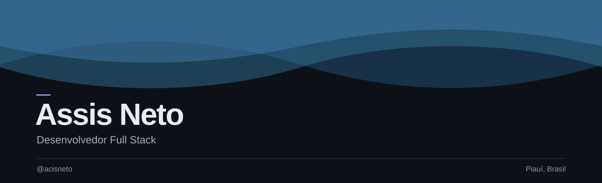

  

   

  
  
  

Sou **Francisco de Assis (Assis Neto)**, desenvolvedor **Full Stack** e estudante de **Ciência da Computação**, no Piauí.

Trabalho com desenvolvimento de aplicações web, sistemas sob medida, integrações e automação. Tenho interesse especial por produtos que transformam processos complicados em ferramentas simples de usar, da estrutura dos dados à interface final.

Minha trajetória também passa pelo **design de interfaces**, o que influencia a forma como penso em navegação, acessibilidade, organização da informação e experiência de uso.

## Atuação

- **Desenvolvimento de sistemas:** aplicações web, painéis administrativos, módulos de gestão e APIs.
- **Interfaces e produto:** UI/UX, prototipação, componentes reutilizáveis, SVG e motion design.
- **Integrações e automação:** APIs REST, WebSockets, processamento de dados e fluxos automatizados.
- **IA aplicada:** estudos e protótipos envolvendo transcrição de áudio, modelos locais e apoio à operação de sistemas.
- **Análise de sistemas e dados:** investigação de comportamentos, inconsistências e incidentes em ambientes operacionais.
- **Suporte a integrações:** acompanhamento e análise técnica de integrações entre sistemas.
- **Sistemas de saúde:** atuação com as plataformas **TASY** e **SOLUS** no contexto de operadoras.
- **Infraestrutura e ferramentas técnicas:** uso de **SQL, Postman, Docker e Kubernetes** no trabalho com sistemas e operações.
- **Suporte técnico operacional:** investigação de problemas e colaboração com equipes e usuários para manter os fluxos de trabalho funcionando.

### Desenvolvimento independente

Além da experiência em análise de sistemas, atuo no desenvolvimento de aplicações web e produtos digitais, do planejamento e da interface à implementação, integração e publicação. Gosto de unir raciocínio técnico, clareza visual e conhecimento do problema que o software precisa resolver.

## Projetos selecionados

| Projeto | Descrição | Área |
| :--- | :--- | :--- |
| **[Bonfire Library](https://bonfireproject.online/)** | Biblioteca pessoal de filmes e séries com catálogo, perfis e player web integrado. | Full Stack · Mídia · UI/UX |
| **[Buscador-PI](https://buscadorpi.vercel.app/)** | Plataforma de consulta a unidades e serviços públicos do Piauí, organizada por município e categoria. | Dados públicos · Full Stack |
| **Litoral Hub** | Projeto acadêmico para reunir informações úteis a turistas, pescadores e praticantes de esportes no litoral piauiense. | APIs · Produto · UX |
| **[Museu do Mar de Parnaíba](https://museudomarphb.com.br/)** | Site institucional com informações sobre história, acervo, visitação e programação. | Web · Conteúdo · UI/UX |
| **[ADESG-SP](https://adesgsp.org.br/)** | Site institucional com estrutura para cursos, eventos, notícias e informações da organização. | Desenvolvimento Web · UI/UX |

Também atuo em **sistemas de gestão, organização de atendimentos, dashboards operacionais e integrações entre serviços**. Parte desses trabalhos pertence a clientes ou está em desenvolvimento, por isso não possui código público.

### Bonfire Library

Desenvolvo a **[Bonfire Library](https://bonfireproject.online/)**, uma aplicação Full Stack para organizar bibliotecas pessoais de filmes e séries e reproduzir mídia no navegador. O projeto reúne catálogo, player e perfis em uma experiência inspirada em plataformas de streaming.

- **Catálogo e personalização:** busca e metadados do TMDB, organização por temporadas e episódios, coleções de filmes e progresso de reprodução individual por perfil.
- **Player e processamento de mídia:** integração com WebTorrent, transmissão HLS com FFmpeg e HLS.js, seleção de faixas de áudio e suporte a legendas embutidas e ao OpenSubtitles.
- **Interface e acessibilidade:** layout responsivo, versões em português e inglês e efeitos de *liquid glass* que respeitam as preferências de movimento e transparência do dispositivo.

**Tecnologias:** `JavaScript` · `Node.js` · `Express` · `WebTorrent` · `FFmpeg` · `HLS.js` · `Tailwind CSS` · `daisyUI` · `APIs REST`

### Código público

- **[MUSEU-DO-MAR](https://github.com/acisneto/MUSEU-DO-MAR)** — experimentos visuais e animações SVG. As ondas do banner deste perfil têm origem nessa linha de experimentação.
- **[ID Generator for Velo](https://github.com/acisneto/ID-Generator-for-VELO)** — utilitário para geração de identificadores em projetos Wix Velo.
- **[Dynamic Multi-State Boxes](https://github.com/acisneto/Dynamic-Multi-State-Boxes)** — lógica para interfaces de múltiplos estados.
- **[Reactive Flags for Dynamic Pages](https://github.com/acisneto/Reactive-Flags-for-Dynamic-Pages)** — comportamentos reativos em páginas dinâmicas.

## Tecnologias e ferramentas

**Linguagens e runtime**

  
  
  
  
  
  

**Interface, criação e deploy**

  
  
  
  
  
  

**Análise de sistemas e ambiente corporativo**

  
  
  
  
  
  

**Competências profissionais:** análise de dados e sistemas · diagnóstico de incidentes · suporte a integrações · apoio técnico a operações · sistemas de gestão em saúde.

**Outras áreas de trabalho:** APIs REST · WebSockets · SVG · design responsivo · integração de dados · automação de processos.

## Em constante aprendizado

Estudo **Ciência da Computação** e gosto de explorar o que conecta engenharia de software e problemas reais. Tenho interesse em arquitetura de aplicações, processamento de dados, recursos de IA e tecnologias voltadas à informação pública.

<!--
  OPCIONAL: Snake das contribuições.
  O workflow .github/workflows/snake.yml gera as imagens na branch "output".
  Após a primeira execução, remova este comentário e seu fechamento para exibir a animação.

  <picture>
    <source media="(prefers-color-scheme: dark)" srcset="https://raw.githubusercontent.com/acisneto/acisneto/output/github-contribution-grid-snake-dark.svg" />
    <source media="(prefers-color-scheme: light)" srcset="https://raw.githubusercontent.com/acisneto/acisneto/output/github-contribution-grid-snake.svg" />
    
  </picture>

-->

  Desenvolvimento, design e curiosidade técnica.

